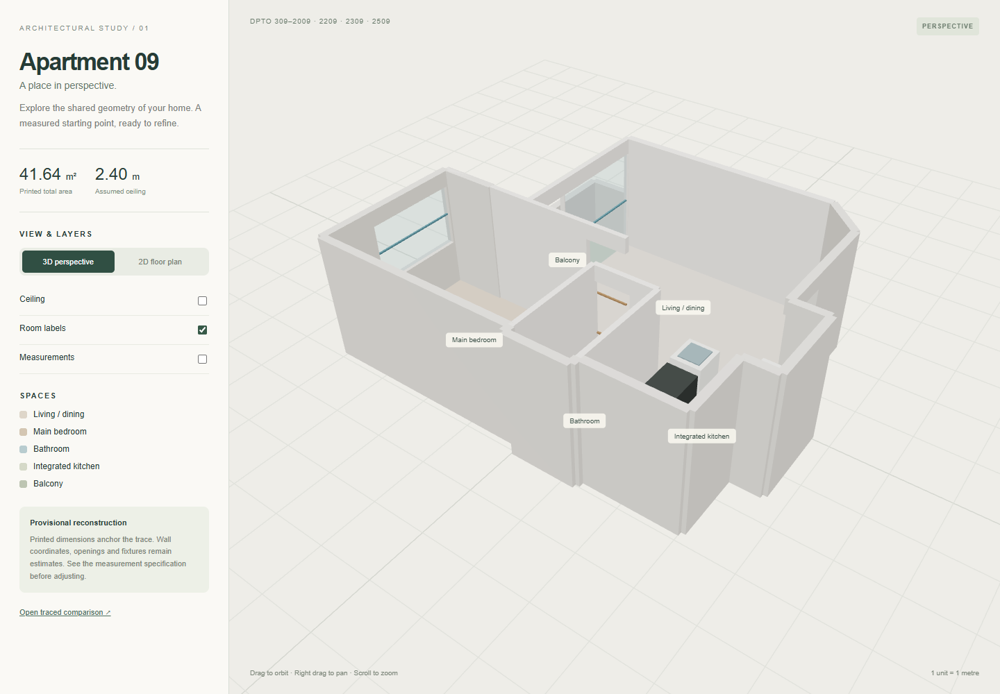
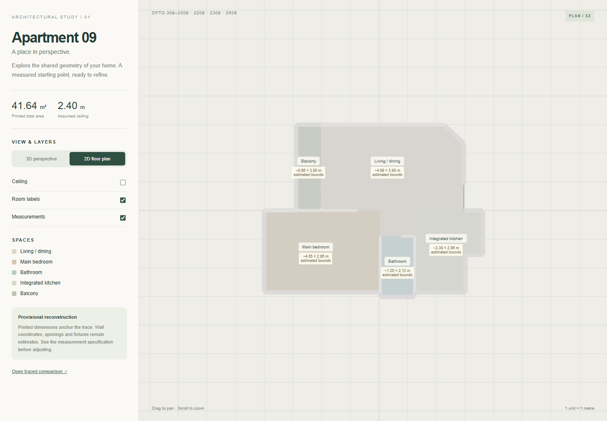
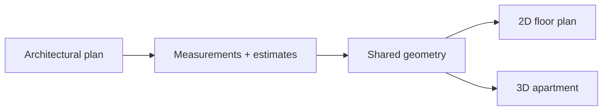

# Apartment 09

Interactive 2D/3D reconstruction of DPTO 09 based on the supplied architectural plan. TypeScript, React Three Fiber, Drei and Vite. No backend.

| 3D interior | 2D floor plan |
| --- | --- |
|  |  |

## Run locally

Node.js 22.12+ recommended.

```sh
npm ci
npm run dev
```

Open the URL printed by Vite. For a production preview: `npm run build && npm run preview`.

## Explore

| Action | Control |
| --- | --- |
| Orbit / pan / zoom | Drag / right-drag / scroll or pinch |
| Switch views | **2D floor plan** / **3D perspective** |
| Reveal interiors | Turn **Ceiling** off in 3D |
| Show annotations | Toggle **Room labels** / **Measurements** |
| Compare the trace | Open the source comparison in the sidebar |

2D disables rotation and cuts walls down. Gold rails mark assumed door openings; blue glazing marks estimated windows.

## How the model works



Edit dimensions, confidence, shared vertices, walls, openings and fixtures in [`data/measurements.json`](data/measurements.json). Values are metres; opening offsets follow walls from a to b. Preserve shared vertex IDs, run validation and compare against the source after edits.

[Geometry guide](docs/geometry.md) · [Assumptions and evidence](docs/assumptions.md) · [Source trace](public/source-plan.svg)

## Accuracy

> **For spatial understanding, not construction.** The plan states **41.64 m²**; the traced partition measures **38.56 m² (-7.39%)**. Area conventions and wall/shaft allocation remain uncertain; the model was not stretched to match. Only explicitly printed dimensions are verified. Coordinates, openings and fixture layouts are estimates; ceiling and other elevations are defaults.

## Check changes

```sh
npm run test:cli
npm run validate
npm run build
npm run apartment -- test
```

Browser checks require Chrome setup. See [automation and test guide](docs/automation.md) for setup, CLI commands and screenshot reports, or [deployment guide](docs/deployment.md) for CI and Vercel previews.
