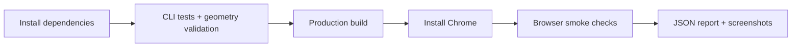

# CI and deployment

[README](../README.md) · [Automation and browser checks](automation.md)

## GitHub checks

Every PR targeting `main` and push to `main` triggers [Browser tests](../.github/workflows/browser-tests.yml):



CI runs the same `npm run apartment -- test` command as local checks, using software WebGL for runners without GPUs. It installs Chrome and required system libraries.

Open **PR → Checks → Browser tests → Details**, download the **browser-report-<attempt>** artifact, and inspect `report.json` and its PNGs. A blocked browser launch fails checks. This workflow does **not** create a public preview URL or require Vercel deployment secrets.

## Vercel preview

[`vercel.json`](../vercel.json) selects Vite, runs geometry validation and the production build, and publishes `dist/`. Configuration alone does not deploy anything; a Vercel account/project connection is required.

From the branch you want to preview:

```sh
npx vercel
```

Sign in and link or create a project when prompted. Omit `--prod` to create a preview rather than a production deployment. For ongoing per-PR previews, connect this GitHub repository to the Vercel project and use `main` as the production branch.

Test a reachable preview with the [browser setup](automation.md#setup) complete:

```sh
npm run apartment -- test --url https://YOUR-PREVIEW.vercel.app
```

The test browser must be able to reach the app. An authentication page will fail checks.

[Vercel Vite reference](https://vercel.com/docs/frameworks/frontend/vite).
